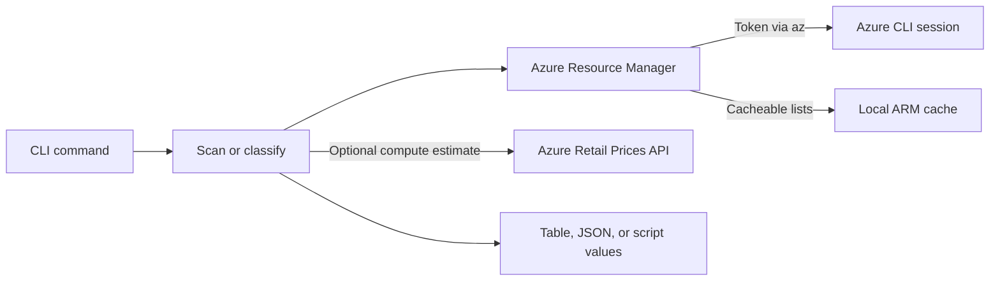

# Architecture

[README](../README.md) · [Command standard](command-standard.md) · [JSON contracts](json-contracts.md)

`az-where` combines read-only Azure signals into region, VM SKU, and resource-type verdicts. Both binaries, `azw` and `az-where`, run the compiled `dist/cli.js`.

## Request flow

- [CLI entry point](../src/cli.ts) registers Commander handlers, loads the version, and rewrites legacy positional VM shorthand. The [command handlers](../src/commands/) resolve scope and format the results.
- [Azure CLI adapter](../src/core/az.ts) runs `az` for account context, diagnostics, and authentication. The [ARM client](../src/core/arm.ts) memoizes the bearer token in process memory, follows list pagination, and retries transient failures.
- [Geography](../src/core/geo.ts) filters Azure’s subscription locations to usable physical regions and applies geography groups or a region selector.
- [Pricing](../src/core/pricing.ts) queries the public Retail Prices API for optional on-demand compute estimates. Pricing is independent of the verdict.

## How verdicts are made

### Virtual machines

[VM scanning](../src/core/scan.ts) checks allowed-location policy, looks up the SKU in the regional Compute catalog, reads subscription restrictions, and compares the instance’s vCPU requirement with live VM-family quota. `FULL` includes any quota shortfall, even when some vCPUs remain. `QUOTA_UNKNOWN` covers missing usage data and usage-request failures.

[VM comparison](../src/core/compare.ts) reuses the same regional SKU catalog and usage data for multiple requested sizes. [Family search](../src/core/available.ts) uses those data sources to group matching sizes with available regions.

### Generic resources

[Resource discovery](../src/core/resources.ts) resolves friendly aliases or raw ARM resource types and classifies regions from the subscription’s provider catalog. `resources` lists catalog entries. The result carries `availability` confidence. Provider registration is surfaced as evidence, and service-specific constraints such as SKU, quota and capacity are outside this check.

[Resource comparison](../src/core/compareResource.ts) classifies all requested types from a single catalog load. `pick resource` returns the first region advertising all requested types in geography-group and region-name order. `suggest resource` uses the same candidates and can rank them by proximity using the [built-in coordinates](../src/core/suggest.ts).

### Storage SKUs

The [Storage SKU check and scan](../src/core/storage.ts) use the subscription-scoped Storage SKU list. They match the requested account kind and SKU against catalog entries for each region and evaluate explicit location restrictions. The catalog is read live once per invocation and follows ARM pagination. Matching rows without enough location or restriction data can produce an inconclusive result.

### Infrastructure files

[The IaC parser](../src/core/iac.ts) extracts literal VM and scale-set location/size pairs and literal locations for mapped generic resource types in Terraform and Bicep. It reports dynamic locations or VM sizes as skipped. It reads the supplied files directly, without evaluating variables or following modules.

[Verification](../src/core/verify.ts) groups VM checks by region to reuse catalog and usage data. A literal scale-set capacity multiplies the required vCPUs. Generic resources share a provider-catalog load across all files.

## Policy, cache, and credentials

[Policy handling](../src/core/policy.ts) reads subscription policy assignments live and intersects the enforced allowed-location lists it recognizes. `pick` and `suggest` fail if the policy read fails, unless invoked with `--no-policy`. Other verdict commands can report results with incomplete policy evidence. Check `policy.checked` and `policy.error` before relying on a JSON verdict.

[ARM caching](../src/core/cache.ts) stores subscription locations, provider catalog data, and Compute SKU lists for 10 minutes. Entries are keyed by subscription ID and request path. `--refresh` bypasses cache reads and refreshes the downloaded data. Quota and policy results are always read live when checked. The cache stores catalog responses, and credentials stay in memory.

[Release checks](../src/core/updateCheck.ts) use a separate 24-hour cache for GitHub update notifications. The explicit `update` command refreshes release information and can install a package after interactive confirmation.

## Output and failures

[Explanations](../src/core/explain.ts) translate observed verdict evidence into a reason and an optional hint. [Payload builders](../src/core/payloads.ts) assemble most versioned JSON responses. The [JSON contracts](json-contracts.md) describe their fields and command-specific exit behavior.

Human output is formatted for the terminal. Progress uses stderr and is suppressed in machine output modes. The [error handler](../src/core/errors.ts) maps typed errors to stderr output and [exit codes](../README.md#exit-codes).
